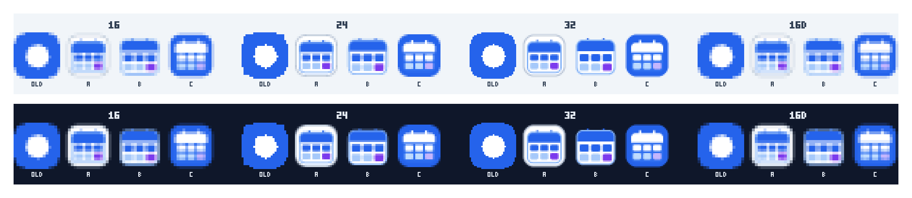

# 作业日程 — 应用图标设计（rev9-icon）

> 需求已与用户确认：**现代平面风格**；**白色底**；**毛玻璃质感**；**画面正中一个日历图标**。

| 项 | 内容 |
|---|---|
| 日期 | 2026-09-14 |
| 分支 | `feature/app-icon-rev9`（基于 master @ `62b7e7a`，不合并、不推送） |
| 范围 | `electron/icon.png` 重制（electron-builder `win.icon`：exe / 安装包 / 桌面快捷方式图标）；**托盘 `tray.png` 不动** |
| 产物 | 1024×1024 RGBA PNG（透明外圈）；生成脚本 `electron/make-icon.js`；多尺寸验证 strip |

---

## 1. 需求拆解

| # | 要求 | 目标定义 |
|---|---|---|
| R1 | 现代平面风格 | 纯色/微渐变填充，无写实高光与 3D 投影；软阴影仅用于层次 |
| R2 | 白色底 | 视觉主调为白/近白（144° 冷调白渐变），蓝紫色仅作角落氛围与图形 |
| R3 | 毛玻璃质感 | 真实 `backdrop-filter` 折射下层色斑 + 斜向高光 + 微粒噪点 + 内高光 |
| R4 | 居中日历 | 日历图形（含装订环）几何中心与画面中心重合，无文字 |
| R5 | 小尺寸可辨识 | 16–32px 下仍能读作「白底上的日历」；无细碎元素（最小图形单元 = 日期格，1024 下 136×116） |
| R6 | 可复现来源 | 提交生成脚本（内嵌 HTML/SVG，headless Chromium 渲染），产物与脚本同库 |

## 2. 设计 tokens

| token | 值 | 用途 |
|---|---|---|
| 画布 | 1024×1024（透明） | electron-builder ≥256 要求之上留足余量 |
| 圆角方形底 | 864×864，圆角 216（25%），四周 80 透明安全边 | 现代平面圆角方形；透明外圈允许 |
| 主色 blue | `#2563eb`（顶栏渐变 `#3b82f6 → #2563eb`） | 与应用主题蓝一致；顶栏 / 日期格 / 装订环 / 色斑 |
| 点缀 violet | `#7c3aed` | 第 6 个日期格 + 右下角色斑 |
| 深蓝 shadow | `#1e40af` @ 16–22% | 图块与日历卡的柔影 |
| 浅蓝 cell | `#bdd6fb` | 第二行日期格（弱层级） |
| 白色玻璃 | `rgba(255,255,255,0.38–0.97)` 多层 | 图块玻璃层 / 卡底 / 内高光 |

## 3. 构图与分层（自下而上）

```
画布 1024×1024（透明）
└─ 圆角方形图块 864×864 r216（外部三层柔影，透明外圈可见）
   ├─ 底色：165° 冷调白渐变 #ffffff → #f4f8ff → #e9f0fd
   ├─ 色斑：左上蓝 r0.62 / 右下紫 r0.52 / 右上白光 r0.95（blur 18–36px，被裁于图块内）
   ├─ 斜向高光带：-24° 白色渐变条（blur 30px）＝玻璃镜面反光
   ├─ 玻璃层：backdrop-filter blur(40px) saturate(170%) + 白色内描边 + 顶部内高光
   ├─ 噪点：feTurbulence fractalNoise，overlay 6%＝毛玻璃微粒
   └─ 居中日历（SVG 660×660，几何中心 = 画布中心）
      ├─ 装订环 ×2：36×86 r18 主色（藏于卡上缘之后，露出 54）
      ├─ 卡底：600×548 r68，白→#f6f9ff 半透明微渐变（浅色玻璃感）＋ 深蓝柔影 ＋ 淡蓝描边
      ├─ 顶栏：150 高主色微渐变（上圆角随卡、下直角）
      └─ 日期格 2×3：136×116 r30；第一行实心主色 ×3；第二行 #bdd6fb ×2 + violet ×1
```

- 日历图形（环顶 130 → 卡底 732，图块高 864）上下留白 130/132，`R4` 居中成立。
- 全部无文字（R1/R5）；无外部字体依赖（不触发字体加载差异）。

## 4. 渲染管线（`electron/make-icon.js`）

- 依赖探测：`require("playwright-core")` → `PLAYWRIGHT_CORE_PATH` → `%LOCALAPPDATA%\npm-cache\_npx\*\node_modules\playwright-core`。
- Chromium 探测：`CHROMIUM_EXE` → `%LOCALAPPDATA%\ms-playwright\chromium-*\chrome-win64\chrome.exe`（取最高版本）。
- **headless 合成**（`launch({ headless: true })`），无任何可见窗口；`setContent` 内嵌 HTML/SVG，`requestAnimationFrame ×2 + 250ms` 等待合成后 `screenshot({ omitBackground: true })` 输出透明外圈 PNG。
- 预览：读回 icon.png → data URI → 在棋盘格上并排渲染 1024/256/64/32/16 并逐一元素截图 + 整条 strip，写入 `%TEMP%\opencode\pwtest\icon-rev9\`（`--preview-dir` / `--no-preview` 可调）。
- 用法：`node make-icon.js`（覆盖 `electron/icon.png`）。

## 5. 验证与留证（实测）

- 产物：`electron/icon.png` = 1024×1024、8bit RGBA（colorType 6）、275,327 bytes；透明外圈经 strip 棋盘格背景确认。
- **Read 读图自评**（1024 与 strip，两轮）：
  - v1：构图/居中/白底达标，但毛玻璃感偏弱（近纯白）、卡影偏灰。→ 增强色斑与高光带、玻璃层饱和度、噪点 4.5%→6%；卡底改半透明微渐变；卡影减淡；浅蓝格加深。
  - v2（定稿）：白底毛玻璃可读（左上蓝 / 右下紫 + 斜向反光 + 微粒），日历居中、无脏边锯齿过噪。
  - 小尺寸：256px 完整清晰；64px 日历结构（顶栏/日期格/紫格）可辨；32px 读作「白底小日历」；16px 保有蓝色主体剪影（白底图标在纯白背景的固有限制，非缺陷）。
- 引用同步：`electron/package.json` 无需改（`win.icon="icon.png"` 自动转 .ico，1024 ≥ 256）；`electron/README.md` 表行已更新；`make-tray-icon.js` 不再写 `icon.png`（防止旧 256 蓝底圆点覆盖新图标），托盘产物与逻辑零变更。

## 6. 文件清单

| 文件 | 变更 |
|---|---|
| `electron/make-icon.js` | 新增：图标生成脚本（内嵌 HTML/SVG，headless Chromium 渲染 + 多尺寸预览） |
| `electron/icon.png` | 重制：256×256 蓝底白圆点（1,930 B）→ 1024×1024 白底毛玻璃日历（275,327 B） |
| `electron/make-tray-icon.js` | 修改：仅生成 `tray.png`，不再覆盖 `icon.png`（托盘输出零变更） |
| `electron/README.md` | 修改：图标一行说明补充 `make-icon.js` |
| 本文档 | 新增：设计说明与实测记录 |

---

## 7. 托盘图标重制（rev9-tray，`fix/tray-icon-rev9`）

> 背景：用户已安装新构建，但系统托盘仍是旧的「蓝底白圆点」——`tray.png` 未随应用图标更新（`main.js::createTray()` 经 `nativeImage.createFromPath(tray.png)` 加载，32×32）。

**要求**：与应用图标同一设计语言（蓝色日历 + 白/透明底 + 紫色点缀）；去掉玻璃噪点与细碎元素；16–32px 托盘尺寸清晰可辨；保持 32×32 RGBA（加载逻辑不改）；抗锯齿（4× 超采样）；纯 Node 内置模块生成（无第三方依赖）。

### 7.1 候选与选择

| 候选 | 构图 | 16px 表现（浅/深底实测） | 结论 |
|---|---|---|---|
| **A** | 白色圆角底板 + 蓝色日历（缩微 icon.png，元素粗化） | 浅底：白板融入任务栏，蓝顶栏/日期格/紫格可辨；深底：白板清晰，读作「迷你 icon.png」 | **定稿** |
| B | 透明底 + 蓝色日历（无底板） | 图形更大更清楚，但浅底上白卡身消失、整体偏「浮」；深底表现好 | 次选（更轻） |
| C | 蓝底 + 白色日历（反色） | 16px 最清楚（白顶栏/白格高对比），但蓝方块剪影与**旧图标**几乎同族（首屏易误读为「还是老图标」），且反色偏离白底语言 | 未选 |

**选择 A 的理由**：① 最忠实于新应用图标（白底圆角 + 蓝日历 + 紫格，同一套 tokens）；② 16px 下蓝顶栏与日期格可辨（实测见 §7.3），浅底优雅退化、深底呈迷你 icon.png；③ 与旧图差异一目了然，兑现「换新」预期；④ B/C 以 `--candidate b|c` 保留，随时可切换。



### 7.2 生成管线（`electron/make-tray-icon.js` 重写，纯 Node）

- **4× 超采样**：所有图形按 32 单位设计坐标绘制到 128×128，再 4×4 **盒式降采样**到 32（预乘 alpha 平均，透明边不发黑）→ 硬边缘问题消除（旧版无 AA）。
- 图形原语：圆角矩形/矩形填充 + 绘制顺序遮罩（日历环藏于卡后、顶栏圆角随卡下缘取直）。
- 同一 `drawCandidate*` 以不同尺寸重渲染即可得到 16/24/32 原生 AA 小图（预览用）。
- 预览对照条：内置 3×5 位图字体（无字体/外部依赖），浅（#f1f5f9）/深（#0f172a）两条带 × 16/24/32/**16D**（交付 32px 盒式降到 16px，模拟系统缩放）× OLD/A/B/C；旧图经内置 PNG 解码器读取（zlib.inflate + 反滤波，支持 filter 0–4）。
- 用法：`node make-tray-icon.js`（写 tray.png + 预览）；`--candidate b|c`、`--preview-dir`、`--old`、`--sheet-out`、`--no-preview`。
- 预览落盘 `%TEMP%\opencode\pwtest\tray-rev9\`：`cand-{a,b,c}-{16,24,32}.png`、`tray-final-{16,24,32}.png`、`tray-rev9-16zoom.png`（16px ×24 放大）、`tray-rev9-sheet.png`。

### 7.3 实测（Read 读图 + 像素探针）

- 定稿产物：`tray.png` = 32×32、8bit RGBA、592 B（旧 185 B）；像素探针：底板 `#FFFFFF`、顶栏/日期格 `#2563EB`、点缀格 `#7C3AED`、四角 A=0（透明）。
- 16px 放大对照（×24）：A 可见「白板 + 蓝顶栏 + 一行蓝格 + 一行浅蓝格 + 紫点缀」；B 图形更大但无底板；C 最清楚。24/32px：A/B/C 均清晰无锯齿，小尺寸无过噪。
- **v1→v2 迭代**：首版 16px 元素过细（大量像素为 AA 边缘 → 发灰）。粗化修正：顶栏 5.2→6.4、日期格 4.9×3.7→5.6×4.4、行距/格距加大、卡描边加深加粗、第二行浅蓝 `#bdd6fb`→`#a6c9fa`、底板描边 `#cbd5e1`→`#b9c5d6`；16px 恢复实体蓝结构。
- 口径说明：main.js 托盘加载逻辑未改（仍 32×32 `tray.png`）；窗口 `icon:` 可选行**未加**——主窗口与贴边条均 `skipTaskbar:true`（无边框透明窗口），加窗口图标无任何可见收益，故保持最小 diff。

### 7.4 文件清单（本小节）

| 文件 | 变更 |
|---|---|
| `electron/make-tray-icon.js` | 重写：候选 A/B/C + 4× 超采样 + 预览对照条（纯 Node 零依赖） |
| `electron/tray.png` | 重制：蓝底白圆点（185 B）→ 白底圆角 + 蓝日历（592 B，32×32 RGBA，AA） |
| `docs/superpowers/specs/2026-09-14-tray-icon-rev9-comparison.png` | 新增：候选 16/24/32/16D × 浅/深底 × 含旧图对照 |
| 本文档 | 追加本小节 |
